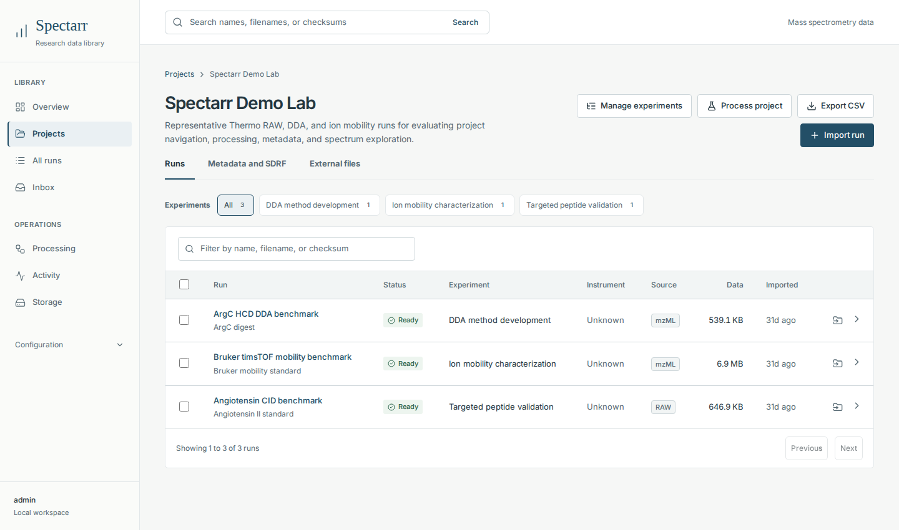
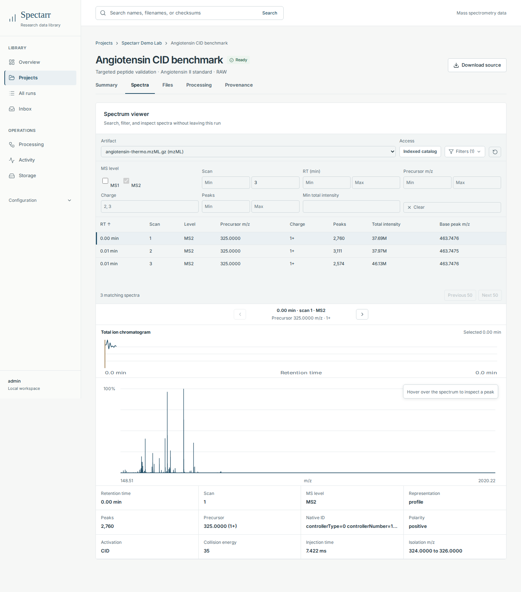

# Spectarr

### A self-hosted home for mass spectrometry data

Find the original run. See the spectrum. Know how the processed file was made.

Spectarr brings instrument files, projects, samples, and processing history into one searchable web app. Built for researchers and lab teams with data scattered across acquisition PCs, shared drives, and folders full of filenames.

[Get started](#get-started) · [Documentation](docs/README.md) · [Releases](https://github.com/pgarrett-scripps/spectarr/releases) · [Report a bug](https://github.com/pgarrett-scripps/spectarr/issues)

[](https://github.com/pgarrett-scripps/spectarr/actions/workflows/ci.yml)
[](LICENSE)




*Projects keep samples, source files, generated formats, and metadata together. Screenshot from the running app with demonstration data.*

## From scattered files to a research library

- **Find your data.** Group runs by project and experiment. Search by name, original filename, or checksum.
- **Look inside a run.** Explore spectra and chromatograms without opening a separate desktop viewer.
- **Keep the original.** Source acquisitions are checksummed and preserved. Derivatives keep their processing history.
- **Make useful formats.** Generate mzML, mzXML, MGF, and MS2 with recorded conversion settings.
- **Bring data in your way.** Upload in the browser, import public PRIDE datasets, or collect completed acquisitions with the Windows or Linux agent.
- **Keep using your tools.** A readable file library, REST API, webhooks, and read-only MCP access connect Spectarr to the rest of your workflow.



*Inspect spectra, filter scans, and follow the chromatogram in your browser.*

## Get started

You need a **Linux x86-64 server with Docker Engine and Docker Compose v2**. The app runs in one container with SQLite. Vendor conversion launches separate ProteoWizard containers through the Docker socket.

In a new directory on your server:

```bash
mkdir spectarr && cd spectarr
curl -fL -o compose.yaml https://github.com/pgarrett-scripps/spectarr/releases/latest/download/compose.yaml
docker compose up -d --wait
```

Open **[http://localhost:3280](http://localhost:3280)** and create your administrator account. No database setup or `.env` file is required. Secrets are generated automatically, and your library persists in `./data`.

**Installing on another machine?** Run `ssh -N -L 3280:127.0.0.1:3280 user@your-server` on your computer, then open the same address. The [installation guide](release/README.md) covers HTTPS access for your team, storage paths, rootless Docker, updates, and backups.

To explore without instrument data, download [the small demo MGF](https://raw.githubusercontent.com/pgarrett-scripps/spectarr/main/examples/demo.mgf), choose **Import data**, and open the imported run's **Spectra** tab. [First-run walkthrough →](docs/getting-started.md)

Docker socket access gives the converter control of its Docker daemon. Use a trusted host, and see the [deployment notes](release/README.md#docker-and-vendor-conversion) before opening access to others.

## Your data, on your storage

Spectarr supports mzML, mzXML, MGF, MS2, Thermo RAW, and Bruker directory acquisitions, with reader and conversion support varying by format. Originals and derivatives remain ordinary files on your server. You can keep large artifacts on separate storage while the database stays on local disk.

[Formats and storage](docs/data-and-storage.md) · [Instrument collection](services/agent/README.md) · [Backups and recovery](docs/backup-integration.md)

## Try it with your workflow

Spectarr is an early-stage project with published releases. Feedback from researchers, core facilities, and self-hosters is welcome, especially around setup, instrument compatibility, and everyday data organization. Validate your own vendor files and acquisition patterns before relying on unattended collection.

[Open an issue](https://github.com/pgarrett-scripps/spectarr/issues) · [Contribute](CONTRIBUTING.md) · [Security policy](SECURITY.md) · [Apache 2.0 license](LICENSE)
